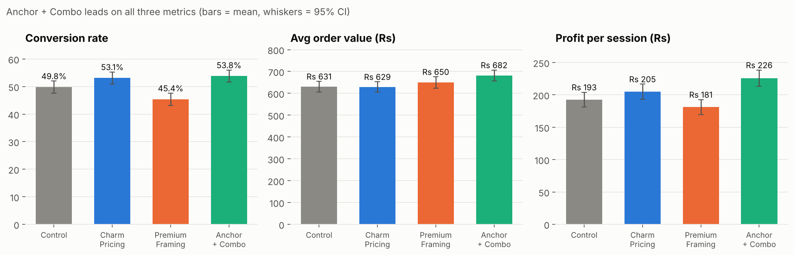
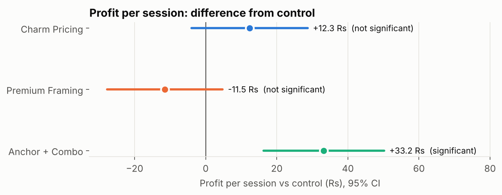
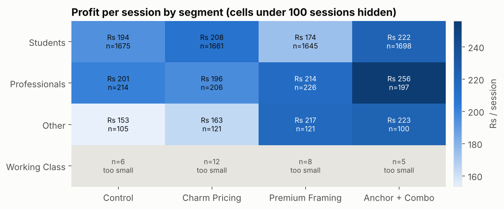

# Restaurant Price Optimization: A Product Analytics Experiment

Can a restaurant earn more by changing **how prices are presented** on its digital menu, without blanket discounts?

This project designs and analyses a **four-arm randomized pricing experiment** (control vs. charm pricing, premium framing and anchor-plus-combo). Variants are evaluated on a pre-defined metric hierarchy with significance testing and customer segmentation, and the analysis ends in a staged rollout recommendation.

> **Data integrity.** Consumer profiles, budgets, occupations and ratings come from the genuine **UCI Restaurant & Consumer Data** set. Treatment assignment and commercial outcomes (orders, prices, costs) are **simulated** and labelled as such, because no public dataset contains real restaurant A/B-test outcomes. All uplift figures are **modelled / projected, not achieved in production**.

---

## Key result

**Recommended: D – Anchor + Combo.** It delivers the highest contribution profit per session and is the only variant with a statistically significant profit gain over control.

| Metric | Control | Anchor + Combo | Lift |
|---|---|---|---|
| Conversion rate | 49.8% | 53.8% | +8.0% |
| Average order value | ₹630.56 | ₹681.86 | +8.1% |
| Revenue per session | ₹314.02 | ₹366.84 | +16.8% |
| **Profit per session** | **₹192.64** | **₹225.83** | **+17.2%** |

At 50,000 monthly sessions this implies **≈ ₹16.6 lakh incremental contribution profit per month** (95% bootstrap interval ₹8.2–25.1 lakh). This is a modelled projection.



---

## Experiment design

| Variant | What the customer sees | Hypothesis |
|---|---|---|
| **A – Control** | Rounded prices, standard descriptions | Causal benchmark |
| **B – Charm Pricing** | Prices ending in 9 (₹299) | Lower perceived price → higher conversion, mainly for budget-sensitive users |
| **C – Premium Framing** | Premium descriptions, higher reference value | Higher willingness to pay, at some conversion cost |
| **D – Anchor + Combo** | Expensive anchor item next to a framed value combo | Combo looks like a deal → more orders **and** bigger baskets |

- **Primary metric:** contribution profit per session (= net revenue − 34% food cost − ₹18 packaging − 1.8% payment fee; non-ordering sessions count as ₹0)
- **Secondary metrics:** conversion, AOV, revenue per session, units per order
- **Guardrails:** conversion may not fall > 2 pp vs control; discount rate
- **Sample:** 8,000 sessions, 2,000 per arm, randomized and balanced

## Statistical validation

| Test | Result | Conclusion |
|---|---|---|
| Sample-ratio mismatch (χ² goodness of fit) | p = 1.00 | Allocation balanced |
| Chi-square: conversion × variant | χ² = 35.32, p = 1.0 × 10⁻⁷ | Conversion depends on variant |
| Two-proportion z-tests vs control (Holm) | B, C, D all p < 0.05 | B and D raise conversion, C lowers it |
| One-way ANOVA: order value | F = 4.02, p = 0.007 | Order value differs across variants |
| Tukey HSD: order value | D > A (p = 0.018), D > B (p = 0.012) | D vs C not significant (p = 0.27) |
| **Welch t-test: profit/session vs control (Holm)** | **D: +₹33.2, 95% CI ₹16–50, p < 0.001** | **Only D is significantly more profitable** |
| Bootstrap (5,000 resamples) | Interval excludes zero | Confirms the t-test without normality assumptions |



Charm pricing significantly lifts conversion but **not** profit. That is why the decision rests on the primary metric rather than on conversion alone.

## Segmentation



Anchor + Combo leads for Students (≈ 83% of sessions) and Professionals. Premium Framing beats control only among Professionals, which fits their higher willingness to pay. The Working Class segment has 5–12 sessions per variant and is excluded as too small. Segment findings are exploratory and point to a **targeted-pricing follow-up test**.

## Recommendation & rollout

1. **Pilot:** 10% of traffic for 2 weeks, with **user-level** assignment.
2. **Scale to 50%** only if profit/session stays positive, conversion drops by less than 2 pp, and cancellation/refund/complaint guardrails hold.
3. **Full rollout** with a small permanent holdout.
4. **Next experiment:** charm pricing for low-budget users, premium framing for high-budget users.

## Limitations

- Treatment effects are simulation inputs. The project demonstrates the experimentation workflow; a live pilot is needed to establish real impact.
- Randomization is at session level and every user appears in all arms. A production test should randomize by user to avoid contamination.
- With 2,000 sessions per arm, the minimum detectable conversion effect is ≈ 4.4 pp at 80% power. D's +4.0 pp is borderline, and a live test should be sized larger.
- UCI consumers are from Mexico, while prices and costs are illustrative INR inputs. Novelty effects, repeat purchase, competitor response and kitchen capacity are not modelled.

---

## Repository structure

```
restaurant-price-optimization/
├── data/
│   ├── raw/uci/                     # genuine UCI tables (ratings, consumer profiles, restaurants)
│   └── processed/
│       └── restaurant_pricing_experiment_dataset.csv   # 8,000 simulated sessions (all results use this)
├── notebooks/
│   └── restaurant_price_optimization.ipynb   # full narrative analysis, executed
├── src/
│   ├── config.py        # paths, experiment design, every modelling assumption in one place
│   ├── simulate.py      # builds sessions from UCI data
│   ├── economics.py     # revenue, variable cost and contribution profit
│   ├── analysis.py      # KPIs, SRM, MDE, chi-square, ANOVA, Tukey, Welch, bootstrap, impact
│   ├── plots.py         # charts
│   └── run_analysis.py  # one command: tables + figures
├── outputs/
│   ├── figures/         # PNG charts used above
│   └── tables/          # CSV results
└── reports/             # PDF report and Excel workbook
```

## How to run

```bash
git clone https://github.com/Sanidhyabhandari12/restaurant-price-optimization.git
cd restaurant-price-optimization
pip install -r requirements.txt

python -m src.run_analysis        # reproduces every table and chart in outputs/
jupyter notebook notebooks/restaurant_price_optimization.ipynb
```

To regenerate a fresh simulated dataset (statistically equivalent; individual random draws differ):

```bash
python -m src.simulate --seed 42                      # -> data/processed/regenerated_sessions.csv
python -m src.run_analysis --data data/processed/regenerated_sessions.csv
```

## Tech stack

Python · pandas · NumPy · SciPy · statsmodels · matplotlib · Jupyter

## Data source & licence

Vargas-Govea, B., González-Serna, J. G., & Ponce-Medellín, R. *Restaurant & Consumer Data*. UCI Machine Learning Repository. DOI [10.24432/C5DP41](https://doi.org/10.24432/C5DP41). Licensed under [CC BY 4.0](https://creativecommons.org/licenses/by/4.0/).
The code in this repository is released under the MIT License.

## Author

**Sanidhya Bhandari** · B.Tech Chemical Engineering (Minor in Management), IIT Gandhinagar
[GitHub](https://github.com/Sanidhyabhandari12) · [LinkedIn](https://www.linkedin.com/in/sanidhya-bhandari-bb50b9326)
